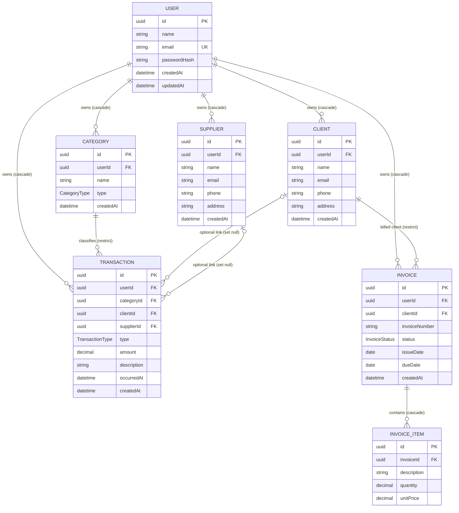

# ProfitX — Entity Relationship Diagram

## Enums

- `TransactionType`: `INCOME`, `EXPENSE`.
- `CategoryType`: `INCOME`, `EXPENSE`.
- `InvoiceStatus`: `DRAFT`, `SENT`, `PAID`, `OVERDUE`, `CANCELLED`.

## Transaction fields and relationships

- `type` is required and uses `TransactionType` (`INCOME` or `EXPENSE`).
- `amount` is required and stored as `Decimal(12, 2)`.
- `occurredAt` is required and defaults to the current timestamp; `createdAt` records when the row was created.
- `userId` is required. Deleting the owning user cascades and deletes that user's transactions.
- `categoryId` is required and references one category. Deleting a category that a transaction references is restricted, so the transaction remains intact.
- `clientId` and `supplierId` are nullable optional references. Deleting the linked client or supplier keeps the transaction and sets the corresponding reference to `NULL`.
- The application-level convention is to associate income with a client and expenses with a supplier. The current schema does not enforce that pairing as a database constraint.

## Invoice fields and relationships

- `invoiceNumber` is required, stored as `VarChar(50)`, and unique per user through the compound unique constraint `(userId, invoiceNumber)`. Another user may reuse the same number.
- `status` is required, uses `InvoiceStatus`, and defaults to `DRAFT`.
- `issueDate` is required and stored as `DATE`; it defaults to the current date. `dueDate` is optional and stored as `DATE`. Both keep a date without a time component.
- `clientId` is required and references one client of the same user. Deleting a client that still has invoices is restricted so invoice history remains valid.
- `userId` is required. Deleting the owning user cascades to that user's invoices and their items.
- The API requires at least one item per invoice. This rule is enforced by the service, not by a database constraint.
- `InvoiceItem.description` is required and stored as `VarChar(300)`.
- `InvoiceItem.quantity` is required and stored as `Decimal(12, 3)` with a default of `1.0`.
- `InvoiceItem.unitPrice` is required and stored as `Decimal(12, 2)`.
- Neither the line total nor the invoice total is stored; both are calculated from the item fields.

## Other relationships and delete behavior

- `Client`, `Supplier`, `Category`, `Transaction`, and `Invoice` belong to one user. Deleting a user cascades to those owned records.
- An invoice belongs to one client. Deleting a client with invoices is restricted so invoice history remains valid.
- An invoice item belongs to one invoice. Deleting an invoice cascades to its items.
- `passwordHash` stores a password hash, never a plain-text password.
- Financial reports should count transactions as income or expenses. An invoice alone is not a recorded payment.

## Indexes in `schema.prisma`

- `User.email` has a unique index for login and duplicate prevention.
- `Client` and `Supplier` have unique compound indexes on `(userId, email)` and regular indexes on `(userId, name)`. These support per-user email checks and user-scoped name listing. Their leading `userId` columns also support user-scoped lookups.
- `Category` has a unique compound index on `(userId, name, type)`.
- `Transaction` has indexes on `(userId, occurredAt)`, `(userId, type, occurredAt)`, and `categoryId`.
- `Invoice` has a unique compound index on `(userId, invoiceNumber)` and indexes on `(clientId, issueDate)`, `(userId, status)`, and `(userId, dueDate)`. The last two support user-scoped filtering by status and due date.
- `InvoiceItem` has an index on `invoiceId`.

The compound indexes beginning with `userId` also serve queries filtering by `userId`; separate single-column indexes would duplicate those index prefixes.
